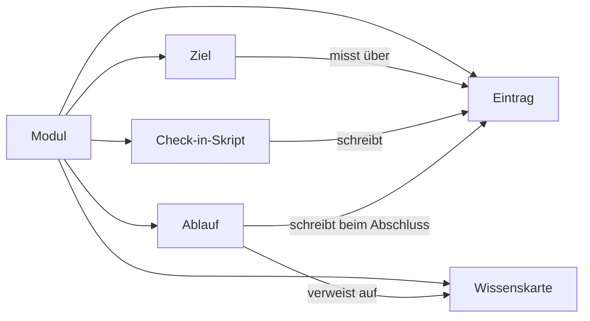

# 04 · Bausteine

Neue Funktionen werden aus sechs festen Bausteinen zusammengesetzt statt jedes Mal neu programmiert. Fast alles aus der Hantelwoche passt schon hinein; dort war es jeweils für einen einzigen Zweck fest verdrahtet.

## Modul

Ein Paket aus Säule, Heute-Karte, Plus-Kacheln, Eintragsarten, Kennzahlen und Wissen. Ein- und ausschaltbar im Profil.

| Feld | Bedeutung |
|---|---|
| `id`, `name`, `saeule` | Kennung, Anzeigename, Säule |
| `eintraege` | Eintragsarten, die das Modul mitbringt |
| `karte` | Karte auf der Startseite (optional) |
| `plus` | Kacheln im Plus-Menü (Erfassen oder Starten) |
| `kennzahlen` | Werte für Ringe, Überblick und Rückblick, z. B. „Meditation: Tage mit Eintrag pro Woche“ |
| `wissen` | zugehörige Wissenskarten (Filter) |
| `ziel_vorlagen` | vorgeschlagene Ziele |

Beispiele: Krafttraining, Mobility, Atmung, Meditation, Selbsthilfe, Lesen, Supplements, Wasser, Journal, Laufen.

## Eintrag

Ein Wert mit Zeit, Art und Säule. **Alles Gemessene ist ein Eintrag**, alle Diagramme lesen dieselben Einträge.

| Typ | Beispiel |
|---|---|
| Zahl (mit Einheit) | Gewicht 67,4 kg, Schlaf 7,2 h, Wasser 2 l, Ruhepuls 54 |
| Ja/Nein | Supplement genommen, Block erledigt |
| Skala 1–5 | Stimmung, Stress, Erholung |
| Dauer | Lesen 25 min, Meditation 10 min |
| Text | Notiz, Journal, Gedankenprotokoll |
| Liste | Körperbereiche mit Muskelkater |
| Satz-Protokoll | Krafteinheit: pro Übung Sätze mit kg und Wdh. |

In der Hantelwoche waren das Einzelfelder im Tagesdokument (`sleep`, `steps`, `supps`, `check`, `breath`, `psy`). Diese werden einmalig in Einträge übernommen ([Datenmodell](05-datenmodell.md)).

## Ablauf

Eine Folge von Schritten mit Timer, Text, Bild und Ton. Trägt Training, Yoga, Mobility, Atmung, Meditation, Selbsthilfe und künftig Routinen.

| Schritt-Feld | Bedeutung |
|---|---|
| `name` | Anzeige, z. B. „Taube · links“ |
| `dauer` | Sekunden, oder „bis Weiter“ |
| `uebung` | Verweis auf eine Wissenskarte (Bild, Tipps) |
| `hinweis` | Text unter dem Timer |
| `art` | Arbeit, Pause, Atemmuster, Satz (mit kg/Wdh.) |

Arten von Abläufen:
- **Fest:** Liste von Schritten, z. B. [Yoga-Flow 20 min](../inhalt/ablaeufe/gefuehrt/yoga20.md).
- **Sätze:** Krafteinheit mit Übungen, Sätzen, Wiederholungsbereich, Pausen, Supersätzen, z. B. [Kraft A](../inhalt/ablaeufe/kraft-a.md).
- **Runden:** Zirkel mit Arbeit/Pause/Rundenpause, z. B. [Tabata](../inhalt/ablaeufe/vorlagen/x-tabata.md).
- **Generiert:** aus einem Baukasten nach Eingaben zusammengestellt, z. B. [Mobility nach Gefühl](../inhalt/mobility/koerperbereiche.md).
- **Atemmuster:** Rhythmus aus Phasen, z. B. [Box-Atmung](../inhalt/atmung/box.md).

Ideen: Morgenroutine 10 min, Pomodoro, Kälte-Dusche, Feierabendroutine.

## Check-in-Skript

Fragen mit Verzweigungen („Schmerzen? ja → wo?“) und einer Auswertung am Ende. Selbst schreibbar.

| Teil | Bedeutung |
|---|---|
| Frage | Text, Untertitel, Antwortart (Auswahl, Mehrfachauswahl, Zahl, Text, Körperbereiche) |
| Verzweigung | Bedingung, wann eine Frage übersprungen wird |
| Auswertung | Formel für Punktzahl und Ergebnis, Gründe als Sätze |
| Folgen | Was das Ergebnis bewirkt (leichte Variante anbieten, Atemübung vorschlagen) |

Vorhanden: [Tagesampel](../inhalt/check-ins/tagesampel.md). Geplant: Abendrückblick (Energie, was lief gut, was morgen), Wochenrückblick.

## Ziel

Ein Ziel mit Messgröße und Weg.

| Zieltyp | Beispiel | Misst über |
|---|---|---|
| **Stufenpfad** | Klimmzug: 6 Stufen vom aktiven Hängen bis +20 kg | Test pro Stufe |
| **Zielwert** | 70 kg Körpergewicht | Einträge „Gewicht“ |
| **Häufigkeit** | 3× pro Woche Mobility | Einträge „Ablauf erledigt“ |
| **Menge** | 12 Bücher bis Ende 2027 | Einträge „Buch beendet“ |

Die 30 Skills der Skillbank sind Ziele vom Typ Stufenpfad: [inhalt/skills/](../inhalt/skills/README.md). Ziele lassen sich anheften (Startseite, Fortschritt).

**Wochenquote statt Streak:** Häufigkeitsziele zählen pro Woche. Ein Ausfall kippt keine Serie.

## Wissenskarte

Einheitliches Format für alles Nachschlagbare. Jede Karte ist eine Markdown-Datei unter [inhalt/](../inhalt/README.md).

| Teil | Bedeutung |
|---|---|
| Kopf | `id`, `name`, `typ`, `saeule`, Tags, Bild |
| Kurzsatz | Das Wichtigste in einer Zeile |
| Abschnitte | je nach Typ: Ausführung, Häufige Fehler, Atmung, Wo du es spürst, Wann, Warum es hilft, Ablauf, Quellen, Sicherheit |
| Verweise | Wo die Karte vorkommt (Abläufe, Skills) |

Typen: `uebung`, `atemuebung`, `selbsthilfe`, `skill`, später `rezept`, `supplement`, `ratgeber`. Erste Ratgeber-Ideen: Schlaf bei 6–7 h verbessern, Eiweiß ohne Fleisch und Fisch, Büro-Haltung.
