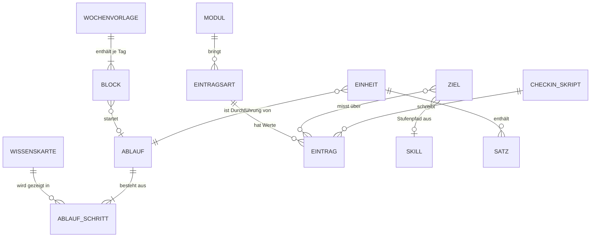

# 05 · Datenmodell

LifeBalance trennt zwei Arten von Daten:

- **Inhalte** (Wissen und Pläne): Übungen, Atemtechniken, Skills, Abläufe, Wochenvorlage, Ernährung. Sie liegen als Markdown-Dateien in [inhalt/](../inhalt/README.md), für alle gleich, und werden von der App gelesen. Aufbau: [Inhaltsformat](12-inhaltsformat.md).
- **Nutzerdaten**: was beim Benutzen entsteht (Einträge, Einheiten, Ziele, Einstellungen). Sie gehören dem Nutzer und liegen nur auf dem Gerät oder verschlüsselt im eigenen Speicher ([Technik](09-technik.md)).



## Nutzerdaten

### Profil

```json
{
  "name": "P",
  "equipment": ["lh", "sz", "bank", "kh", "band", "brett"],
  "klimmzugstange": false,
  "stangen_kg": { "lh": 10, "sz": 7, "kh": 2 },
  "trainingsstart": "2026-10-26",
  "ziele_ernaehrung": { "kcal": 2850, "eiweiss_g": 135 },
  "module": { "kraft": true, "atmung": true, "selbsthilfe": true, "wasser": false },
  "startseite": ["checkin", "naechstes", "ringe", "tagesplan", "schnellstart", "tageswerte", "ziel", "abend"],
  "bildstil": "auto"
}
```

### Eintrag

Jeder gemessene oder abgehakte Wert ist ein Eintrag.

```json
{ "id": "e-1795000000000", "art": "gewicht", "zeit": "2026-11-23T07:10", "wert": 67.4 }
{ "id": "e-1795000000001", "art": "supplement", "zeit": "2026-11-23T07:15", "wert": true, "bezug": "creatine" }
{ "id": "e-1795000000002", "art": "stimmung", "zeit": "2026-11-23T21:00", "wert": 4 }
{ "id": "e-1795000000003", "art": "ablauf", "zeit": "2026-11-23T22:00", "wert": 600, "bezug": "med" }
```

| Feld | Bedeutung |
|---|---|
| `art` | Eintragsart (aus einem Modul oder selbst angelegt) |
| `zeit` | Datum und Uhrzeit (lokal) |
| `wert` | Zahl, Ja/Nein, Skala, Sekunden, Text oder Liste |
| `bezug` | optional: ID eines Inhalts (Übung, Ablauf, Supplement, Skill) |
| `quelle` | optional: `hand`, `health`, `ablauf`, `checkin` |

### Eintragsart

```json
{ "id": "wasser", "name": "Wasser", "saeule": "ernaehrung", "typ": "zahl", "einheit": "l",
  "schritt": 0.25, "tagesziel": 2.5, "plus": true }
```

### Einheit (Krafttraining)

Wie in der Hantelwoche, weil der Steigerungsvorschlag darauf aufbaut:

```json
{
  "id": "w-1792880000000", "ablauf": "kraft-a", "datum": "2026-10-26",
  "start": 1792880000000, "fertig": true, "min": 63, "leicht": false,
  "uebungen": { "1": "deadlift", "4": "bandpull" },
  "saetze": { "1": [ { "kg": 80, "wdh": 5, "fertig": true } ] }
}
```

`uebungen` hält fest, welche Übung wirklich gemacht wurde (Original, Ersatz oder Variante).

### Check-in

Das Ergebnis eines Check-in-Skripts: alle Antworten plus Auswertung.

```json
{ "skript": "tagesampel", "datum": "2026-11-23", "antworten": { "rec": 4, "sleep": 7.2, "sore": 1, "areas": ["beine"], "stress": 2, "motiv": 4 },
  "punkte": 78, "ampel": "g", "gruende": [], "wahl": "normal" }
```

Werte, die auch für sich zählen (Schlaf, Ruhepuls), werden zusätzlich als Einträge gespeichert.

### Ziel

```json
{ "id": "z-klimmzug", "typ": "stufen", "skill": "klimmzug", "stufe": 3, "angeheftet": true,
  "log": [ { "datum": "2026-11-20", "stufe": 3, "wert": 4, "bestanden": false } ] }
{ "id": "z-gewicht", "typ": "zielwert", "art": "gewicht", "ziel": 70, "bis": "2027-06-30" }
{ "id": "z-mobility", "typ": "haeufigkeit", "art": "ablauf", "bezug": ["mob", "yoga20"], "pro_woche": 3 }
{ "id": "z-buecher", "typ": "menge", "art": "buch", "ziel": 12, "bis": "2027-12-31" }
```

### Wochenvorlage (eigene)

Kopie der [Standardwoche](../inhalt/wochenplan/standardwoche.md), vom Nutzer bearbeitet. Ein Block: `{ "zeit": "18:00", "name": "Kraft A", "startet": "kraft-a", "haupt": true }`.

## Übernahme aus der Hantelwoche

Die Hantelwoche speichert Dokumente unter diesen Schlüsseln. Beim ersten Start von LifeBalance werden sie aus einer Sicherungsdatei oder dem Sync-Zweig gelesen und umgewandelt. Vorher wird eine Sicherung angelegt, nichts geht verloren.

| Hantelwoche | Inhalt | Wird zu |
|---|---|---|
| `profile` | Einstellungen, Körpergewicht `bw[]` | Profil; Einträge `gewicht` |
| `d-JJJJ-MM-TT` `.done` | Blöcke erledigt | Einträge `ablauf` bzw. `block` |
| `.supps` | Supplements abgehakt | Einträge `supplement` |
| `.meals`, `.extra` | Mahlzeiten | Einträge `mahlzeit` (kcal, Eiweiß) |
| `.sleep`, `.steps` | Schlaf, Schritte | Einträge `schlaf`, `schritte` |
| `.check` | Tagesampel | Check-in |
| `.breath` | Atemübungen | Einträge `ablauf` mit `bezug` Atemtechnik |
| `.psy` | Selbsthilfe mit Formular | Einträge `selbsthilfe` (Text) |
| `w-<ts>` | Trainingseinheit | Einheit |
| `sk-<id>`, `sk-meta`, `sk-books` | Skill-Stufen, Tests, Bücher | Ziele, Einträge `buch` |
| `mob` | letzte Mobility-Wahl, Atem-Einstellungen | Profil (Vorlieben) |
| `t-<ts>` | eigene Workouts (Editor) | eigene Abläufe |

## Abgeleitete Werte (nicht gespeichert)

| Wert | Regel |
|---|---|
| Trainingswoche | ganze Wochen seit `trainingsstart` + 1 |
| Entlastungswoche | Trainingswoche durch 7 teilbar: Sätze halbiert (aufgerundet) |
| Meditation | Woche 1–2: 5 min, danach 10 min |
| Zone 2 | Woche 1–4: 30 min, ab Woche 5: 40 min |
| Wochenschnitt Gewicht | Mittelwert der Messungen einer Kalenderwoche |
| Ernährungs-Empfehlung | Veränderung über 2 Wochen: < 0,25 kg/Woche → +200 kcal; 0,25–0,5 → passt; > 0,5 → −150 kcal |
| Säulen-Ring | Anteil der heute geplanten Blöcke und Tagesziele der Säule, die erledigt sind |
| Ruhepuls-Basis | Median der letzten 21 Tage (mindestens 3 Werte) |
