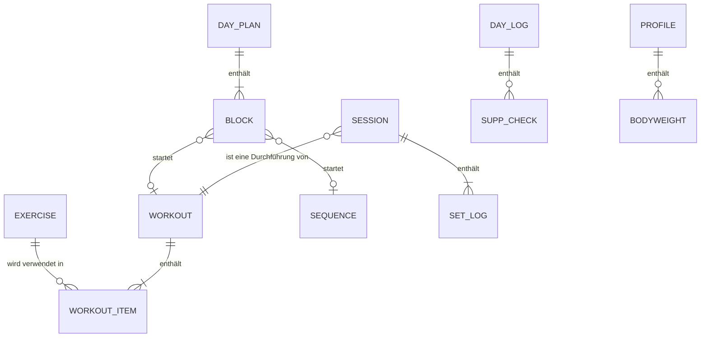

# 03 · Datenmodell

Die App trennt zwei Arten von Daten:

- **Plan-Daten** sind fest im Code (`app/index.html`, Abschnitt „PLAN-DATEN“). Eine Planänderung, z. B. eine neue Übung, ist eine Änderung an diesen Objekten.
- **Nutzerdaten** entstehen beim Benutzen (Sätze, Häkchen, Gewicht). Sie liegen als einzelne JSON-Dokumente in einem Schlüssel-Wert-Speicher.



## Plan-Daten

### Übung (`EX`)

```js
deadlift: {
  n: 'Kreuzheben',            // Anzeigename
  img: 'barbell-deadlifts',   // Dateiname der Animation in img/ (leer = keine)
  eq: 'Langhantel',           // Equipment
  unit: 'kg',                 // kg | bw (Körpergewicht) | band | sec | carry (kg + Meter)
  step: 2.5,                  // Steigerung in kg bei doppelter Progression
  bar: false,                 // braucht Klimmzugstange
  cue: 'Stange über der Fußmitte, Lat anspannen, Boden wegdrücken.',
  mg: 'Po, Beinbeuger, Rücken'
}
```

### Krafteinheit (`WORKOUTS.A | B | C`)

```js
{ g: '4', ex: 'pullup', sets: 4, r: [6, 10], rest: 120,
  alt: { ex: 'bandpull', sets: 3, r: [12, 15] } }   // Ersatz ohne Stange
```

| Feld | Bedeutung |
| --- | --- |
| `g` | Nummer im Plan; gleiche Ziffer mit a/b = im Wechsel |
| `r` | Wiederholungsbereich [unten, oben]; bei `carry` Meter |
| `side` | Angabe pro Seite/Bein |
| `rest` | Pause nach dem Satz in Sekunden (≤ 20 = direkt zur b-Übung) |
| `lab` | Freitext statt Zahl, z. B. „max. minus 2“ |

### Tagesplan (`DAYS[0..6]`, 0 = Sonntag)

```js
{ short: 'Do', name: 'Donnerstag', title: 'Ausdauer und Mobility', blocks: [
  { t: '12:30', n: 'Spaziergang', d: '25 min zügig', seq: 'walk', key: 'walk' },
  { t: '18:00', n: 'Lockere Ausdauer', seq: 'z2', key: 'z2', main: true },
  { t: 'danach', n: 'Mobility-Routine', d: '10 min', seq: 'mob', key: 'mob' },
  { t: '22:00', n: 'Meditation', seq: 'med', key: 'med' } ] }
```

Ein Block startet entweder ein Krafttraining (`train`), einen geführten Ablauf (`seq`) oder springt in eine Ansicht (`go`). `key` ist der Name, unter dem „erledigt“ im Tagesprotokoll steht.

### Geführter Ablauf (`SEQ`)

Eine Funktion, die eine Liste von Schritten liefert. So kann der Ablauf von Einstellungen und Trainingswoche abhängen (Zirkel 40/20 oder 45/15, Meditation 5 oder 10 min).

```js
{ n: 'Thruster mit Kurzhanteln', sec: 40, ex: 'thruster', note: 'Runde 2 von 4', kind: 'work' }
// kind: work | rest | box (Box-Atmung); sec: 0 = wartet auf „Weiter“
```

Weitere feste Listen: `WARMUP` (Einstieg als Checkliste), `SUPPS` (Supplements nach Uhrzeit), `MEALS` (Beispieltag mit geschätzten Nährwerten), `QUICK` (Schnell-Einträge).

## Nutzerdaten

Alle Dokumente liegen flach unter einem Schlüssel. Im Claude-Konto ist das die private Sammlung `data/users/<deine-id>/`, lokal ein Eintrag `hantelwoche-v1` im Browser-Speicher.

| Schlüssel | Inhalt | Anzahl |
| --- | --- | --- |
| `profile` | Einstellungen und Körpergewicht | 1 |
| `d-JJJJ-MM-TT` | Tagesprotokoll | 1 pro benutztem Tag |
| `w-<Zeitstempel>` | eine Trainingseinheit | 1 pro Krafttraining |

### `profile`

```json
{
  "settings": { "start": "2026-10-26", "bar": false, "kcal": 2850, "protein": 135,
                "iron": false, "zinc": false, "circuit45": false, "renegade": 1 },
  "bw": [ { "d": "2026-10-27", "kg": 65.2 }, { "d": "2026-10-29", "kg": 65.4 } ]
}
```

### `d-2026-10-27` (Tagesprotokoll)

```json
{
  "done":  { "walk": true, "yoga": true, "med": false },
  "supps": { "creatine": true, "d3": true, "omega": true, "vitb": true, "multi": false, "mg": false },
  "meals": [0, 2],
  "extra": [ { "n": "Aufbau-Shake", "kcal": 650, "p": 26 } ],
  "sleep": 7.25,
  "steps": 8400
}
```

### `w-1792880000000` (Trainingseinheit)

```json
{
  "type": "A", "date": "2026-10-26", "start": 1792880000000, "finished": true, "min": 63,
  "exmap": { "1": "deadlift", "2": "bss", "4": "bandpull", "6a": "revcrunch" },
  "warm":  { "0": true, "1": true },
  "sets":  {
    "1": [ { "kg": "80", "reps": "5", "done": true }, { "kg": "80", "reps": "5", "done": true },
           { "kg": "80", "reps": "5", "done": true } ],
    "4": [ { "kg": "", "reps": "15", "done": true } ]
  }
}
```

`exmap` hält fest, welche Übung an diesem Tag wirklich gemacht wurde (Original oder Ersatz). Nur so passt der Steigerungsvorschlag später zur richtigen Übung.

## Abgeleitete Werte (werden nicht gespeichert)

| Wert | Regel |
| --- | --- |
| Trainingswoche | ganze Wochen seit `settings.start` + 1 |
| Leichte Woche | Trainingswoche durch 7 teilbar → Sätze halbiert (aufgerundet) |
| Meditation | Woche 1–2: 5 min, danach 10 min |
| Zone 2 | ab Woche 5: 40 statt 30 min |
| Steigerungsvorschlag | letzte abgeschlossene Einheit mit derselben Übung: alle Sätze ≥ obere Wdh.-Zahl → Gewicht + `step`, sonst halten |
| Wochenschnitt Gewicht | Mittelwert aller Messungen einer Kalenderwoche |
| Empfehlung | Veränderung über 2 Wochen: < 0,25 kg/Woche → +200 kcal; 0,25–0,5 → passt; > 0,5 → −150 kcal |

## Grenzen

Ein Dokument darf höchstens 256 KiB groß sein, die Sammlung bis 25.000 Dokumente fassen. Bei einem Tagesprotokoll pro Tag und drei Trainings pro Woche sind das gut 300 Dokumente im Jahr.
