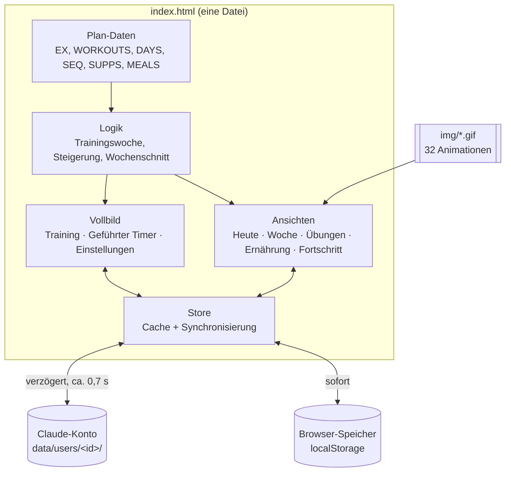

# 04 · Architektur

## Entscheidung

**Eine einzelne Web-Seite (HTML, CSS, JavaScript ohne Framework), veröffentlicht als claude.ai-Artifact.** Dazu gibt es eine Offline-Datei mit eingebetteten Animationen.

| Kriterium | Web-Seite als Artifact | Native App (iOS/Android) | PWA auf eigenem Hosting |
| --- | --- | --- | --- |
| Läuft auf Handy und Laptop | ja | nur Handy, zwei Codebasen | ja |
| Kosten, Server, App-Store | keine | Entwicklerkonto, Store-Prüfung | Hosting und Domain |
| Daten geräteübergreifend | ja, im Claude-Konto | eigener Server nötig | eigener Server nötig |
| Push-Erinnerungen | nein | ja | ja (mit Service Worker) |
| Änderungen ausrollen | sofort, gleicher Link | Store-Update | Upload |

Für eine Person ohne Server ist die Artifact-Variante die schnellste und günstigste. Ihr einziger echter Nachteil sind fehlende Push-Erinnerungen; die lassen sich später über eine PWA-Variante nachrüsten (siehe [06-roadmap.md](06-roadmap.md)).

## Aufbau

### Speicherung

- Jede Änderung landet sofort im Cache und im Browser-Speicher. Die App funktioniert damit auch ohne Verbindung.
- Läuft die Seite als Artifact, verbindet sich der Store mit der Datenbank des Artifacts (`db`-Fähigkeit) und dem privaten Bereich der Person (`user`-Fähigkeit). Schreibvorgänge pro Dokument werden gebündelt (höchstens einer gleichzeitig, kurz verzögert).
- Beim ersten Abgleich werden Einträge, die nur lokal existieren, hochgeladen. Danach gilt die Datenbank als Quelle; Einträge mit noch offenen Schreibvorgängen werden dabei nicht überschrieben.
- Der Bereich `data/users/<id>/` ist privat: Selbst wenn der Link geteilt wird, sieht niemand sonst die Einträge.
- Sicherung: „Daten als Datei sichern“ erzeugt eine JSON-Datei mit allen Dokumenten (im Artifact über die `downloads`-Fähigkeit, in der Offline-Datei als normaler Download). „Sicherung laden“ spielt sie wieder ein.

### Darstellung

- Ansichten werden als HTML-Text aus dem Zustand erzeugt und komplett neu gezeichnet (`render()`); Klicks laufen über einen zentralen Event-Handler mit `data-act`-Attributen.
- Das Training ist ein eigenes Vollbild. Eingaben speichern beim Verlassen des Feldes; beim Neuzeichnen bleibt die Scroll-Position erhalten.
- Timer rechnen mit Endzeitpunkten statt mit Zählern. Dadurch laufen sie richtig weiter, wenn das Handy kurz in eine andere App wechselt.
- Bildschirm-Wachhaltung (Wake Lock) während Training und Timer, Töne über die Web Audio API, Vibration wo verfügbar.
- Farben und Schriften als CSS-Variablen, helles und dunkles Design, Layout ab 360 px; ab 900 px wandert die Tab-Leiste an den linken Rand.

### Offline-Datei

`build_offline.py` bettet alle Animationen als Data-URIs in eine einzelne HTML-Datei (ca. 5,5 MB). Sie läuft per Doppelklick im Browser, speichert aber nur lokal.

## Bewusste Grenzen von Version 0.1

- Kein Service Worker: Im Artifact-Rahmen nicht verfügbar. Ohne Netz hilft die Offline-Datei.
- Keine Push-Erinnerungen (siehe Roadmap).
- Kein Framework und kein Build-Schritt: Für knapp 1.000 Zeilen ist das einfacher zu pflegen. Wächst die App deutlich, ist der Umstieg auf Preact oder Svelte mit Komponenten der nächste Schritt.

## Planänderungen einpflegen

1. Übung in `EX` anlegen oder ändern (Animation nach `img/` legen, falls vorhanden).
2. In `WORKOUTS`, `SEQ` oder `DAYS` eintragen.
3. Artifact neu veröffentlichen (gleicher Link) und `python3 build_offline.py` für die Offline-Datei ausführen.

Gespeicherte Einheiten bleiben gültig, weil sie Übungen über ihre ID (`exmap`) referenzieren.
