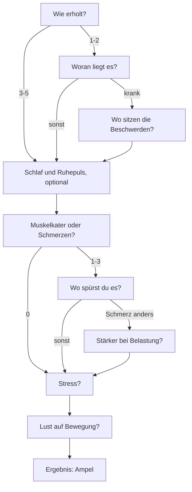

# Check-in-Skript: Tagesampel

Morgendlicher Check-in mit Verzweigungen. Ergebnis: Punktzahl 0–100 und Ampel. Die Auswertung steht in [docs/06-logik.md](../../docs/06-logik.md#tagesampel).

## Ablauf

## Fragen

### `rec`: Wie erholt fühlst du dich heute?

- `1` Völlig platt
- `2` Müde
- `3` Geht so
- `4` Gut
- `5` Topfit

### `cause`: Woran liegt es wohl?

*Mehrere möglich*

- `schlaf` Zu wenig oder schlecht geschlafen
- `stress` Stress oder viel im Kopf
- `training` Training steckt noch in den Knochen
- `krank` Ich werde krank oder bin krank
- `alkohol` Alkohol oder spätes, schweres Essen
- `essen` Zu wenig gegessen oder getrunken
- `weiss` Weiß ich nicht

### `sick`: Wo sitzen die Beschwerden?

- `hals` Nur oberhalb des Halses: Schnupfen, leichtes Kratzen
- `koerper` Im Körper: Fieber, Gliederschmerzen, Husten, Magen-Darm

### `sleep`: Schlaf und Ruhepuls

*Optional. Die Werte findest du in der Health-App (Schlaf, Herz › Ruhepuls). Die Web-App kann die Apple Watch nicht direkt auslesen.*

- Schlaf in Stunden (Zahl)
- Ruhepuls (Zahl)

### `sore`: Muskelkater oder Schmerzen?

- `0` Nichts
- `1` Leichter Muskelkater
- `2` Deutlicher Muskelkater
- `3` Schmerz, der sich anders anfühlt: stechend, im Gelenk, einseitig

### `areas`: Wo spürst du es?

*Antippen, mehrere möglich*

Körperbereiche aus [Mobility](../mobility/koerperbereiche.md) plus Oberschenkel vorne, Knie, Arme und Ellbogen, Handgelenke.

### `pain`: Wird der Schmerz bei Bewegung oder Belastung stärker?

- `ja` Ja
- `nein` Nein, eher gleich oder besser

### `stress`: Wie hoch ist dein Stress gerade?

- `1` Ganz entspannt
- `2` Locker
- `3` Normal
- `4` Hoch
- `5` Sehr hoch

### `motiv`: Wie viel Lust hast du heute auf Bewegung?

- `1` Gar keine
- `2` Wenig
- `3` Mittel
- `4` Ziemlich
- `5` Richtig Lust

## Ampel

- **Grün:** Bereit
- **Gelb:** Mit Bedacht
- **Rot:** Erholung zuerst

Bei Gelb kann man „leichte Variante“ wählen: 2/3 der Sätze mit 90 % des Gewichts.
