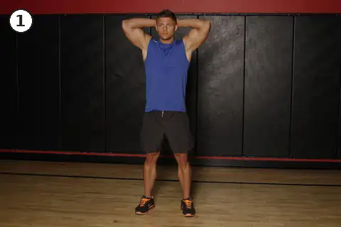

# Kniebeugen ohne Gewicht

> Hüftbreit, tief runter, Fersen bleiben am Boden, Brust hoch.

- **Muskeln/Bereich:** Oberschenkel, Po
- **Equipment:** Körpergewicht
- **Kategorie:** Beine und Po
- **Erfassung:** Körpergewicht, Wiederholungen
