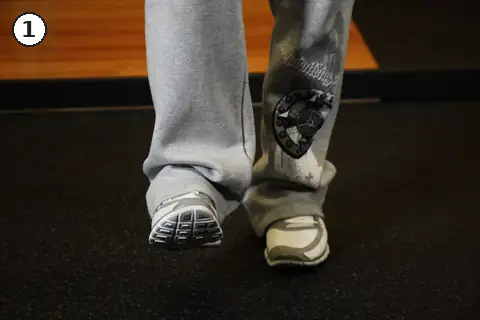

# Fußkreisen

> Fuß anheben und langsam große Kreise in beide Richtungen ziehen.

- **Muskeln/Bereich:** Sprunggelenke
- **Equipment:** Körpergewicht
- **Kategorie:** Mobility
- **Erfassung:** Sekunden (Halten)

## Kommt vor in

- [Mobility nach Gefühl: Waden und Sprunggelenk](../mobility/koerperbereiche.md)
