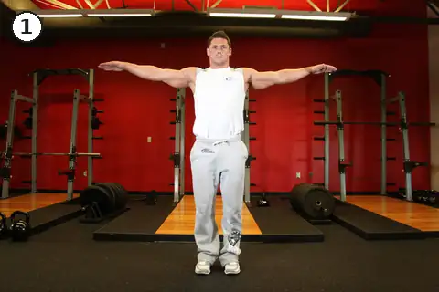

# Armkreisen

> Arme seitlich gestreckt, kleine bis große Kreise vorwärts und rückwärts.

- **Muskeln/Bereich:** Schultern
- **Equipment:** Körpergewicht
- **Kategorie:** Mobility
- **Erfassung:** Sekunden (Halten)

## Kommt vor in

- [Mobility nach Gefühl: Schultern und Brust](../mobility/koerperbereiche.md)
