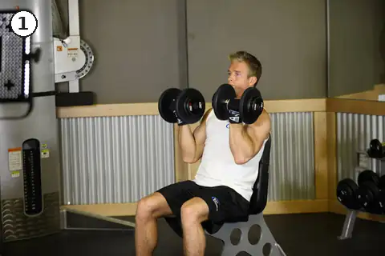

# Arnold Press

> Start mit Handflächen zum Gesicht, beim Drücken nach außen drehen.

- **Muskeln/Bereich:** Schultern
- **Equipment:** Kurzhanteln, Bank
- **Kategorie:** Schultern
- **Erfassung:** Gewicht und Wiederholungen, Steigerung 1 kg
- **Hantel:** zwei Kurzhanteln

## Kommt vor in

- [Vorlage Arme und Schultern](../ablaeufe/vorlagen/x-arms.md)
