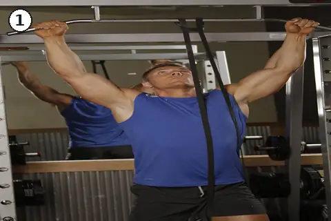

# Klimmzüge mit Bandhilfe

> Band an der Stange, Fuß oder Knie hinein. Volle Bewegung, mit der Zeit ein dünneres Band.

- **Muskeln/Bereich:** Rücken, Bizeps
- **Equipment:** Klimmzugstange, Bänder
- **Kategorie:** Rücken
- **Erfassung:** Band, Wiederholungen
- **Braucht die Klimmzugstange**

## Kommt vor in

- [Skill Klimmzug, Stufe 2](../skills/klimmzug.md)
