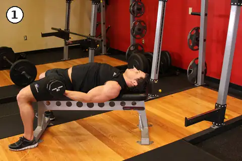

# Around the World

> Auf der Bank liegend die Hanteln mit fast gestreckten Armen in einem großen Bogen von der Hüfte über den Kopf führen.

- **Muskeln/Bereich:** Brust, Schultern
- **Equipment:** Kurzhanteln, Bank
- **Kategorie:** Brust
- **Erfassung:** Gewicht und Wiederholungen, Steigerung 1 kg
- **Hantel:** zwei Kurzhanteln
