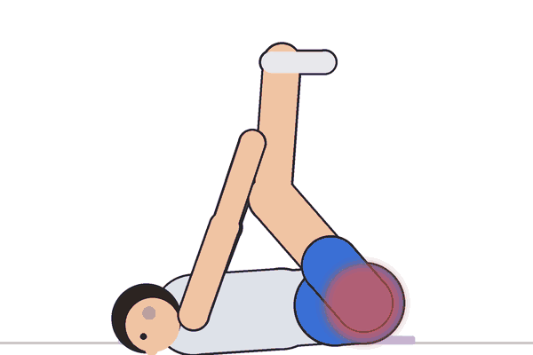

# Glückliches Baby

> Auf dem Rücken, Knie Richtung Achseln, Füße von außen greifen, sanft hin und her schaukeln.

- **Muskeln/Bereich:** Hüfte, unterer Rücken
- **Equipment:** Körpergewicht
- **Kategorie:** Mobility
- **Erfassung:** Sekunden (Halten)

## Ausführung

- Auf dem Rücken, Knie Richtung Achseln ziehen.
- Füße von außen greifen, Fußsohlen zeigen zur Decke.
- Schienbeine senkrecht, Knie weiter als die Hüfte.
- Kreuzbein und Hinterkopf bleiben am Boden, sanft seitlich schaukeln.

## Häufige Fehler

- Kopf und Schultern heben ab. Dann lieber die Kniekehlen greifen.
- Steißbein rollt hoch.

## Atmung

Langsam in den Bauch und unteren Rücken atmen.

## Wo du es spürst

Öffnung in Hüfte und Leiste, Entspannung im unteren Rücken.

## Kommt vor in

- [Yoga · 30 min](../ablaeufe/gefuehrt/yoga30.md)
- [Mobility nach Gefühl: Unterer Rücken](../mobility/koerperbereiche.md)
- [Mobility nach Gefühl: Po](../mobility/koerperbereiche.md)
- [Mobility nach Gefühl: Leiste und Innenseite](../mobility/koerperbereiche.md)
- [Yoga nach Gefühl](../mobility/yoga-baukasten.md)
