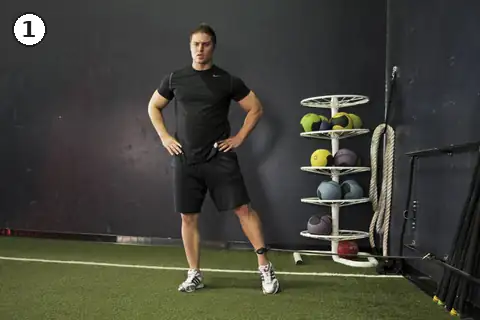

# Adduktion mit Band

> Band seitlich in Knöchelhöhe fixieren, Bein zum Standbein ziehen.

- **Muskeln/Bereich:** Oberschenkel innen
- **Equipment:** Bänder
- **Kategorie:** Beine und Po
- **Erfassung:** Band, Wiederholungen
- **Pro Seite** ausführen
