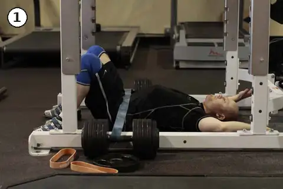

# Hüftbrücke mit Band

> Band über die Hüfte, Enden unter den Händen am Boden. Hüfte hoch, oben Po fest.

- **Muskeln/Bereich:** Po
- **Equipment:** Bänder
- **Kategorie:** Beine und Po
- **Erfassung:** Band, Wiederholungen
