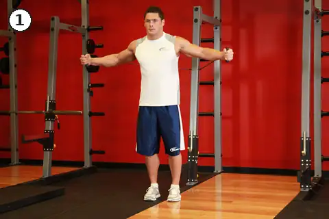

# Band-Crossover

> Band hinter dir in Schulterhöhe, Arme leicht gebeugt vor der Brust zusammenführen.

- **Muskeln/Bereich:** Brust
- **Equipment:** Bänder
- **Kategorie:** Brust
- **Erfassung:** Band, Wiederholungen
