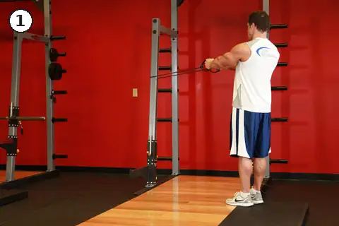

# Reverse Flys mit Band

> Arme fast gestreckt, Band auf Brusthöhe weit auseinanderziehen, Schulterblätter zusammen.

- **Muskeln/Bereich:** Hintere Schulter
- **Equipment:** Bänder
- **Kategorie:** Schultern
- **Erfassung:** Band, Wiederholungen

## Ausführung

- Arme fast gestreckt auf Brusthöhe.
- Weit auseinanderziehen.
- Schulterblätter zusammen.

## Häufige Fehler

- Schultern ziehen hoch.

## Atmung

Ausatmen beim Ziehen.

## Wo du es spürst

Hintere Schulter.

## Kommt vor in

- [Kraft C](../ablaeufe/kraft-c.md) (Variante)
