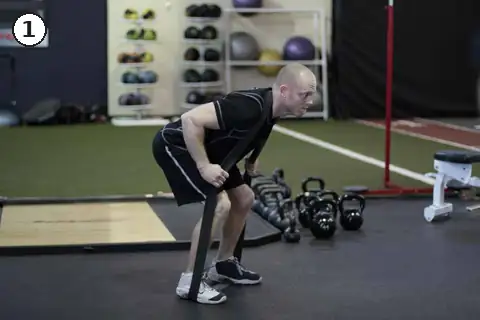

# Good Morning mit Band

> Band unter den Füßen und um den Nacken. Hüfte nach hinten, Rücken gerade, wieder aufrichten.

- **Muskeln/Bereich:** Beinbeuger, unterer Rücken
- **Equipment:** Bänder
- **Kategorie:** Beine und Po
- **Erfassung:** Band, Wiederholungen
