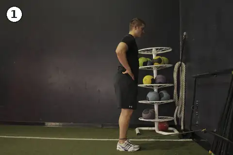

# Bein nach hinten mit Band

> Band um den Knöchel, Bein gestreckt nach hinten drücken, Hüfte bleibt gerade.

- **Muskeln/Bereich:** Po
- **Equipment:** Bänder
- **Kategorie:** Beine und Po
- **Erfassung:** Band, Wiederholungen
- **Pro Seite** ausführen
