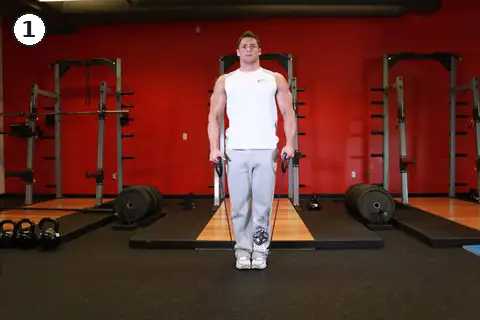

# Seitheben mit Band

> Auf das Band stellen, Arme seitlich bis Schulterhöhe, langsam ablassen. Kein Hantelwechsel nötig.

- **Muskeln/Bereich:** Schultern
- **Equipment:** Bänder
- **Kategorie:** Schultern
- **Erfassung:** Band, Wiederholungen

## Ausführung

- Mittig auf dem Band stehen, Knie weich.
- Ellbogen leicht gebeugt, seitlich bis Schulterhöhe.
- Schultern tief, langsam zurück.

## Häufige Fehler

- Schulter zuckt hoch.

## Atmung

Ausatmen beim Heben.

## Wo du es spürst

Seitliche Schulter.

## Kommt vor in

- [Kraft A](../ablaeufe/kraft-a.md)
- [Kraft C](../ablaeufe/kraft-c.md)
