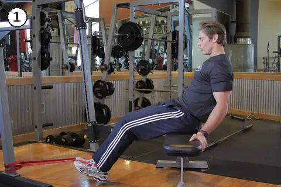

# Beinbeuger-Curl mit Band

> Bauchlage, Band um die Fersen und vorne unten fixiert. Fersen zum Po ziehen.

- **Muskeln/Bereich:** Beinbeuger
- **Equipment:** Bänder
- **Kategorie:** Beine und Po
- **Erfassung:** Band, Wiederholungen
