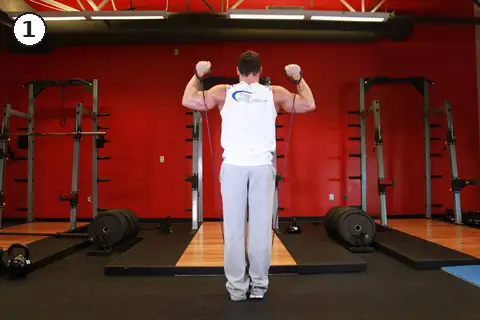

# Schulterdrücken mit Band

> Auf das Band stellen, Hände auf Schulterhöhe, nach oben drücken.

- **Muskeln/Bereich:** Schultern
- **Equipment:** Bänder
- **Kategorie:** Schultern
- **Erfassung:** Band, Wiederholungen
