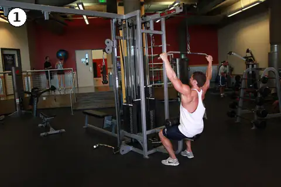

# Latziehen mit Band, kniend

*Hinweis zum Foto: Foto am Latzug, mit Band oben fixiert gleich.*

> Band oben fixieren, Ellbogen Richtung Hüfte ziehen. Ersatz, bis die Stange da ist.

- **Muskeln/Bereich:** Rücken
- **Equipment:** Bänder
- **Kategorie:** Rücken
- **Erfassung:** Band, Wiederholungen

## Ausführung

- Kniend, Band oben fixiert, Arme gestreckt.
- Brust leicht raus, Rumpf aufrecht.
- Ellbogen nach unten zu den Hüften ziehen.
- Unten Schulterblätter zusammen, langsam zurück.

## Häufige Fehler

- Mit dem Oberkörper nach hinten lehnen.

## Atmung

Ausatmen beim Ziehen.

## Wo du es spürst

Seitlicher Rücken.

## Kommt vor in

- [Kraft A](../ablaeufe/kraft-a.md) (Ersatz)
- [Kraft C](../ablaeufe/kraft-c.md) (Ersatz)
