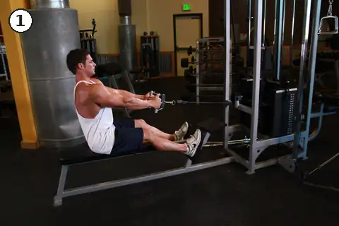

# Rudern mit Band sitzend

*Hinweis zum Foto: Foto am Kabelzug, mit Band gleich.*

> Band um die Füße, Beine fast gestreckt, Oberkörper aufrecht. Ellbogen eng nach hinten ziehen.

- **Muskeln/Bereich:** Rücken
- **Equipment:** Bänder
- **Kategorie:** Rücken
- **Erfassung:** Band, Wiederholungen
