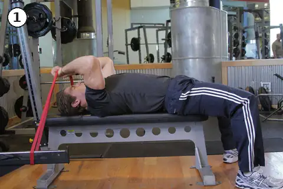

# French Press mit Band

> Liegend, Band unter dem Rücken, nur die Unterarme strecken.

- **Muskeln/Bereich:** Trizeps
- **Equipment:** Bänder
- **Kategorie:** Arme
- **Erfassung:** Band, Wiederholungen
