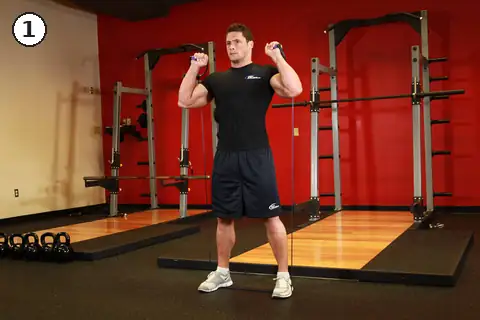

# Kniebeuge mit Band

> Auf dem Band stehen, Enden auf Schulterhöhe halten, tief beugen.

- **Muskeln/Bereich:** Oberschenkel, Po
- **Equipment:** Bänder
- **Kategorie:** Beine und Po
- **Erfassung:** Band, Wiederholungen
