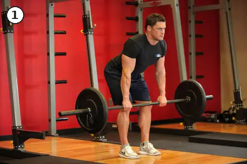

# Langhantelrudern vorgebeugt

> Oberkörper ca. 45° vorgebeugt, Rücken gerade, Stange zum Bauchnabel ziehen und kontrolliert ablassen.

- **Muskeln/Bereich:** Rücken, Bizeps
- **Equipment:** Langhantel
- **Kategorie:** Rücken
- **Erfassung:** Gewicht und Wiederholungen, Steigerung 2.5 kg
- **Hantel:** Langhantel

## Kommt vor in

- [Vorlage Oberkörper Ziehen](../ablaeufe/vorlagen/x-pull.md)
- [Vorlage Langhantel kompakt](../ablaeufe/vorlagen/x-lh.md)
