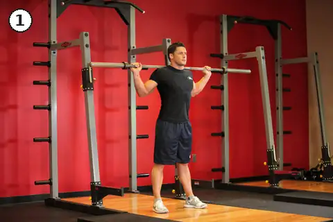

# Seitbeuge mit Langhantel

> Leichte Stange auf dem oberen Rücken, langsam zur Seite neigen und zurück. Nicht nach vorn kippen.

- **Muskeln/Bereich:** Core seitlich
- **Equipment:** Langhantel
- **Kategorie:** Core
- **Erfassung:** Gewicht und Wiederholungen, Steigerung 2.5 kg
- **Hantel:** Langhantel
