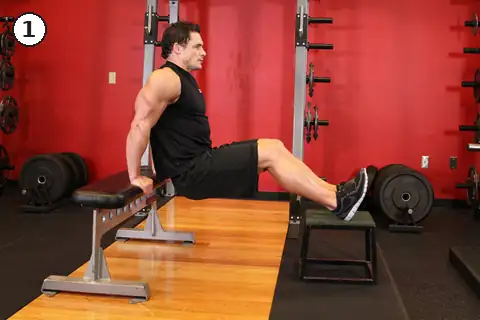

# Dips an der Bank

> Bank mit dem Kopfende an die Wand. Hände an der Kante, Ellbogen nach hinten bis ca. 90° beugen.

- **Muskeln/Bereich:** Trizeps
- **Equipment:** Bank, Körpergewicht
- **Kategorie:** Arme
- **Erfassung:** Körpergewicht, Wiederholungen

## Ausführung

- Hände schulterbreit an der Bankkante, Finger nach vorn.
- Rücken nah an der Bank.
- Ellbogen nach hinten bis ca. 90° beugen.

## Häufige Fehler

- Schultern rollen nach vorn.
- Zu tief absenken.

## Atmung

Ausatmen beim Hochdrücken.

## Wo du es spürst

Trizeps.

## Kommt vor in

- [Kraft B · Beine](../ablaeufe/kraft-b.md) (Variante)
- [Vorlage Calisthenics Drücken](../ablaeufe/vorlagen/x-cpush.md)
- [Skill Muscle-up, Stufe 1](../skills/muscleup.md)
