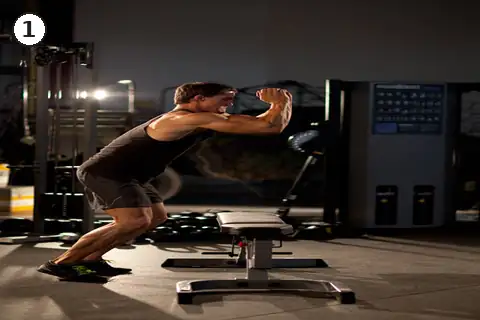

# Sprünge über die Bank

> Seitlich neben der Bank, beidbeinig darüber springen, weich landen. Nur auf rutschfestem Boden.

- **Muskeln/Bereich:** Beine, Schnellkraft
- **Equipment:** Bank
- **Kategorie:** Kondition
- **Erfassung:** Körpergewicht, Wiederholungen
