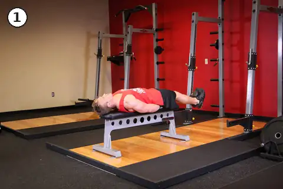

# Beinheben auf der Bank

> Rückenlage, Hände halten die Bank hinter dem Kopf. Gestreckte Beine heben, Becken am Ende leicht einrollen, langsam ablassen.

- **Muskeln/Bereich:** Core (unten)
- **Equipment:** Bank
- **Kategorie:** Core
- **Erfassung:** Körpergewicht, Wiederholungen

## Kommt vor in

- [Skill L-Sit, Stufe 2](../skills/lsit.md)
- [Skill Toes to Bar, Stufe 2](../skills/t2b.md)
- [Skill Dragon Flag, Stufe 2](../skills/dragonflag.md)
