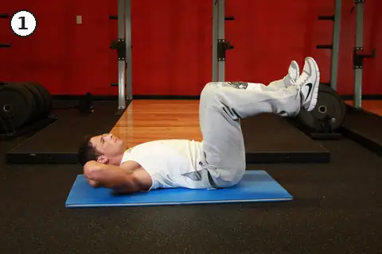

# Fahrrad-Crunch

> Ellbogen zum Gegenknie, anderes Bein strecken. Langsam, unterer Rücken bleibt am Boden.

- **Muskeln/Bereich:** Core, seitliche Bauchmuskeln
- **Equipment:** Körpergewicht
- **Kategorie:** Core
- **Erfassung:** Körpergewicht, Wiederholungen

## Kommt vor in

- [Vorlage Core-Zirkel 20 min](../ablaeufe/vorlagen/x-core3.md)
