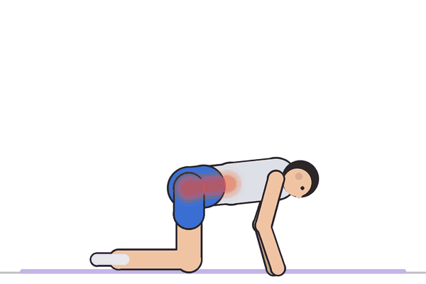

# Bird Dog

> Rücken stabil, 2 s halten.

- **Muskeln/Bereich:** Core, Rücken
- **Equipment:** Körpergewicht
- **Kategorie:** Core
- **Erfassung:** Sekunden (Halten)

## Ausführung

- Vierfüßlerstand, Rücken flach wie ein Tisch.
- Bauch fest, als käme gleich ein leichter Stoß.
- Gegenarm und -bein langsam strecken, bis sie mit dem Rücken eine Linie bilden.
- Becken bleibt waagerecht, die Hüfte dreht nicht auf.
- 2 s halten, kontrolliert zurück.

## Häufige Fehler

- Bein zu hoch, dann folgt das Hohlkreuz.
- Gewicht kippt zur Seite.

## Atmung

Ausatmen beim Strecken, einatmen beim Zurückkommen.

## Wo du es spürst

Rumpfspannung, Po und Rückenstrecker arbeiten.

## Kommt vor in

- [Einstieg](../ablaeufe/gefuehrt/warmup.md)
- [Kondition + Core-Zirkel](../ablaeufe/gefuehrt/circuit.md)
- [Mobility nach Gefühl: Unterer Rücken](../mobility/koerperbereiche.md)
- [Yoga nach Gefühl](../mobility/yoga-baukasten.md)
