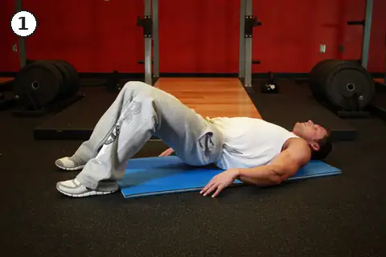
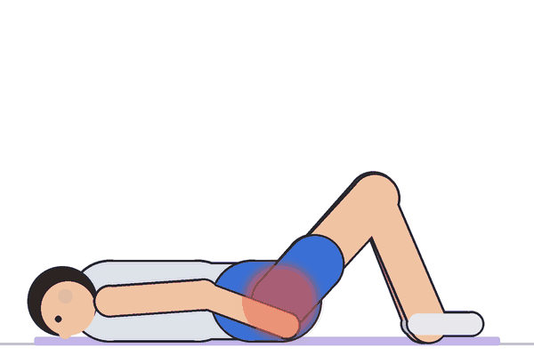

# Hüftbrücke ohne Gewicht

> Po wecken, oben kurz halten.

- **Muskeln/Bereich:** Po
- **Equipment:** Körpergewicht
- **Kategorie:** Beine und Po
- **Erfassung:** Sekunden (Halten)

## Ausführung

- Rückenlage, Füße hüftbreit, Fersen etwa eine Handbreit vor dem Po.
- Becken leicht einrollen, unterer Rücken nah am Boden.
- Durch die Fersen drücken und die Hüfte heben, bis Knie, Hüfte und Schulter eine Linie bilden.
- Oben den Po fest anspannen, Rippen bleiben unten.
- Knie zeigen nach vorn und fallen nicht zusammen.

## Häufige Fehler

- Oben ins Hohlkreuz drücken.
- Aus den Zehen statt aus den Fersen drücken.

## Atmung

Ausatmen beim Hochheben, einatmen beim Absenken.

## Wo du es spürst

Arbeit im Po, nicht im unteren Rücken.

## Kommt vor in

- [Einstieg](../ablaeufe/gefuehrt/warmup.md)
- [Yoga-Flow · 20 min](../ablaeufe/gefuehrt/yoga20.md)
- [Yoga · 30 min](../ablaeufe/gefuehrt/yoga30.md)
- [Mobility nach Gefühl: Unterer Rücken](../mobility/koerperbereiche.md)
- [Mobility nach Gefühl: Po](../mobility/koerperbereiche.md)
- [Yoga nach Gefühl](../mobility/yoga-baukasten.md)
- [Skill Brücke (Rad), Stufe 1](../skills/bruecke.md)
