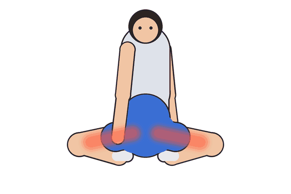

# Schmetterling

> Sitzend Fußsohlen zusammen, Knie sinken nach außen. Füße halten, Rücken lang, mit dem Ausatmen sanft nach vorn neigen.

- **Muskeln/Bereich:** Oberschenkel innen, Hüfte
- **Equipment:** Körpergewicht
- **Kategorie:** Mobility
- **Erfassung:** Sekunden (Halten)

## Ausführung

- Sitzend Fußsohlen zusammen, Fersen in angenehmem Abstand.
- Füße mit den Händen halten, Rücken lang aufrichten.
- Knie sinken lassen, nicht runterdrücken.
- Mit dem Ausatmen mit langem Rücken nach vorn neigen.

## Häufige Fehler

- Mit den Ellbogen die Knie herunterpressen.
- Rund nach vorn fallen.

## Atmung

Lang ausatmen, beim Ausatmen loslassen.

## Wo du es spürst

Dehnung an der Oberschenkel-Innenseite.

## Kommt vor in

- [Mobility nach Gefühl: Leiste und Innenseite](../mobility/koerperbereiche.md)
- [Yoga nach Gefühl](../mobility/yoga-baukasten.md)
