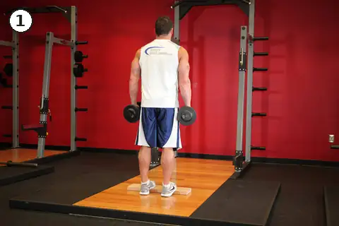

# Wadenheben beidbeinig

> Beide Ballen auf Stufe oder Scheibe, eine Kurzhantel in der Hand, die freie Hand an der Wand. Ferse ganz runter, oben 1 s halten.

- **Muskeln/Bereich:** Waden
- **Equipment:** Kurzhanteln
- **Kategorie:** Beine und Po
- **Erfassung:** Gewicht und Wiederholungen, Steigerung 1 kg

## Ausführung

- Ballen auf der Stufe, Fersen frei.
- Körper aufrecht, Knie gestreckt aber nicht durchgedrückt.
- Ganz nach unten in die Dehnung, dann auf die Zehenspitzen.
- Oben 1 s halten, Gewicht über dem Großzehenballen.

## Häufige Fehler

- Wippen mit Schwung.
- Fuß knickt nach außen.

## Atmung

Ausatmen beim Hochdrücken.

## Wo du es spürst

Waden.

## Kommt vor in

- [Kraft A](../ablaeufe/kraft-a.md)
- [Kraft B · Beine](../ablaeufe/kraft-b.md)
