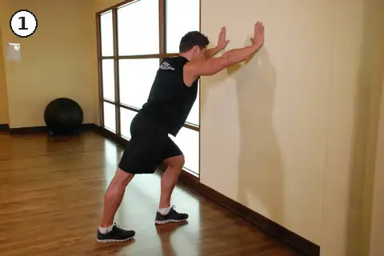
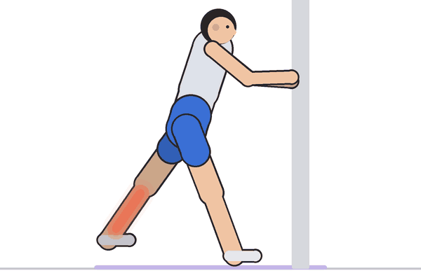

# Waden-Dehnung an der Wand

> Hände an die Wand, hinteres Bein gestreckt, Ferse bleibt am Boden.

- **Muskeln/Bereich:** Waden
- **Equipment:** Körpergewicht
- **Kategorie:** Mobility
- **Erfassung:** Sekunden (Halten)

## Ausführung

- Hände an die Wand, hinteres Bein gestreckt, Ferse fest am Boden.
- Fuß zeigt gerade nach vorn.
- Hüfte nach vorn zur Wand schieben, Körper bleibt eine Linie.
- Danach das hintere Knie leicht beugen, so dehnt sich die tiefe Wadenmuskulatur.

## Häufige Fehler

- Fuß dreht nach außen.
- Ferse hebt ab.

## Atmung

Gleichmäßig atmen, beim Ausatmen etwas weiter zur Wand.

## Wo du es spürst

Ziehen in der Wade bis zur Achillessehne.

## Kommt vor in

- [Kondition + Core-Zirkel](../ablaeufe/gefuehrt/circuit.md)
- [Mobility nach Gefühl: Waden und Sprunggelenk](../mobility/koerperbereiche.md)
- [Yoga nach Gefühl](../mobility/yoga-baukasten.md)
- [Skill Pistol Squat, Stufe 2](../skills/pistol.md)
- [Skill Tiefe Hocke, Stufe 1](../skills/hocke.md)
