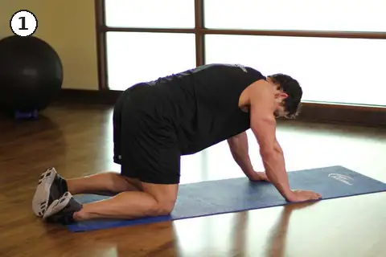
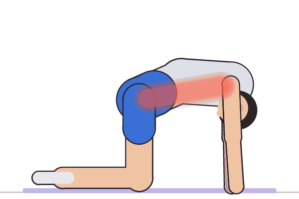

# Katze-Kuh

> Im Vierfüßlerstand, langsam mit dem Atem.

- **Muskeln/Bereich:** Wirbelsäule
- **Equipment:** Körpergewicht
- **Kategorie:** Mobility
- **Erfassung:** Sekunden (Halten)

## Ausführung

- Hände genau unter den Schultern, Knie unter den Hüften, Finger weit gespreizt.
- Ausatmen: Rücken rund wie eine Katze, Steißbein nach unten, Kinn zur Brust.
- Einatmen: Brustbein nach vorn schieben, Becken kippt, Blick leicht nach vorn.
- Die Bewegung beginnt am Becken und rollt Wirbel für Wirbel bis zum Kopf.
- Arme bleiben lang, die Schultern ziehen weg von den Ohren.

## Häufige Fehler

- Nur den Kopf bewegen statt die Wirbelsäule.
- In der Kuh ins Hohlkreuz fallen und die Schultern hochziehen.
- Zu schnell: eine Phase pro Atemzug reicht.

## Atmung

Einatmen in die Kuh, ausatmen in die Katze. Langsam, etwa 4 s pro Richtung.

## Wo du es spürst

Wohlige Bewegung im ganzen Rücken, kein Ziehen im Nacken.

## Kommt vor in

- [Einstieg](../ablaeufe/gefuehrt/warmup.md)
- [Yoga-Flow · 20 min](../ablaeufe/gefuehrt/yoga20.md)
- [Yoga · 30 min](../ablaeufe/gefuehrt/yoga30.md)
- [Mobility-Routine](../ablaeufe/gefuehrt/mob.md)
- [Mobility nach Gefühl: Oberer Rücken](../mobility/koerperbereiche.md)
- [Mobility nach Gefühl: Unterer Rücken](../mobility/koerperbereiche.md)
- [Skill Brücke (Rad), Stufe 1](../skills/bruecke.md)
