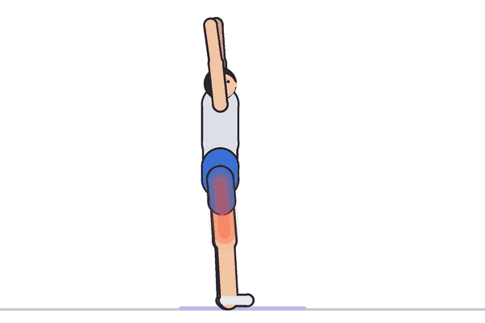

# Stuhl

> Füße hüftbreit, Hüfte nach hinten wie auf einen Stuhl, Arme in Verlängerung des Rückens nach oben. Gewicht auf den Fersen.

- **Muskeln/Bereich:** Oberschenkel, Po, Schultern
- **Equipment:** Körpergewicht
- **Kategorie:** Mobility
- **Erfassung:** Sekunden (Halten)

## Ausführung

- Füße hüftbreit, Gewicht auf den Fersen.
- Hüfte nach hinten schieben, als ob du dich auf einen Stuhl setzt.
- Knie bleiben hinter oder über den Zehen.
- Arme in Verlängerung des Rückens, Rippen bleiben unten.

## Häufige Fehler

- Knie schieben weit nach vorn, Fersen heben ab.
- Hohlkreuz mit herausgestrecktem Bauch.

## Atmung

Ruhig und gleichmäßig weiteratmen.

## Wo du es spürst

Brennen in den Oberschenkeln, Spannung im Po.

## Kommt vor in

- [Yoga nach Gefühl](../mobility/yoga-baukasten.md)
