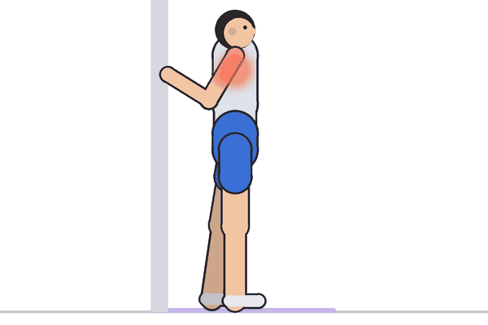

# Brust-Dehnung am Türrahmen

> Arm an den Türrahmen, mit dem Körper nach vorn gehen, bis es in der Brust zieht.

- **Muskeln/Bereich:** Brust, Schulter vorn
- **Equipment:** Unkonventionell
- **Kategorie:** Mobility
- **Erfassung:** Sekunden (Halten)

## Ausführung

- Unterarm an den Türrahmen, Ellbogen etwa auf Schulterhöhe.
- Schulter bleibt tief und hinten, nicht zum Ohr ziehen.
- Mit dem Körper einen kleinen Schritt nach vorn und leicht vom Arm wegdrehen.
- Bauch fest, kein Hohlkreuz.
- Ellbogen höher = obere Brust, tiefer = mittlere Brust.

## Häufige Fehler

- Schulter rollt nach vorn und zieht vorne im Gelenk.
- Zu stark gedreht, sodass Kribbeln im Arm entsteht: dann lockerer.

## Atmung

Ruhig weiteratmen, mit dem Ausatmen etwas weiter drehen.

## Wo du es spürst

Ziehen in Brust und vorderer Schulter, nicht im Gelenk.

## Kommt vor in

- [Kondition + Core-Zirkel](../ablaeufe/gefuehrt/circuit.md)
- [Mobility nach Gefühl: Schultern und Brust](../mobility/koerperbereiche.md)
- [Yoga nach Gefühl](../mobility/yoga-baukasten.md)
- [Skill Brücke (Rad), Stufe 2](../skills/bruecke.md)
- [Skill Schulterbeweglichkeit, Stufe 1](../skills/schulter.md)
