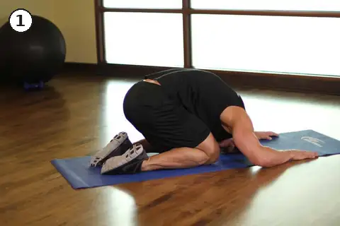
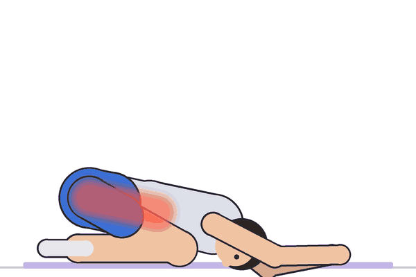

# Kindhaltung

> Po zu den Fersen, Stirn ablegen, Arme lang. Tief in Bauch und Flanken atmen.

- **Muskeln/Bereich:** Rücken, Entspannung
- **Equipment:** Körpergewicht
- **Kategorie:** Mobility
- **Erfassung:** Sekunden (Halten)

## Ausführung

- Knie hüftbreit oder weiter, große Zehen berühren sich.
- Po sinkt Richtung Fersen, Stirn liegt auf dem Boden oder einem Kissen.
- Arme lang nach vorn oder locker neben dem Körper.
- Schultern lösen und schwer werden lassen.

## Häufige Fehler

- Druck auf die Knie aushalten: Kissen zwischen Po und Fersen.
- Nacken verdrehen statt die Stirn abzulegen.

## Atmung

In den Rücken und die Flanken atmen, der Rücken hebt sich beim Einatmen.

## Wo du es spürst

Sanfte Dehnung im ganzen Rücken, Entspannung.

## Kommt vor in

- [Mobility-Routine](../ablaeufe/gefuehrt/mob.md)
- [Mobility nach Gefühl: Oberer Rücken](../mobility/koerperbereiche.md)
- [Mobility nach Gefühl: Unterer Rücken](../mobility/koerperbereiche.md)
- [Yoga nach Gefühl](../mobility/yoga-baukasten.md)
