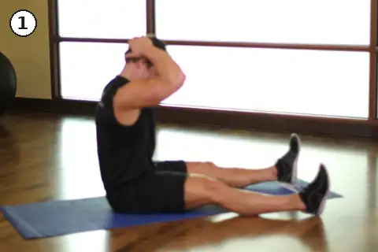

# Nacken-Dehnung Kinn zur Brust

> Kinn sanft zur Brust sinken lassen, Hände nur leicht auflegen, nicht ziehen.

- **Muskeln/Bereich:** Nacken hinten
- **Equipment:** Körpergewicht
- **Kategorie:** Mobility
- **Erfassung:** Sekunden (Halten)

## Kommt vor in

- [Mobility nach Gefühl: Nacken](../mobility/koerperbereiche.md)
