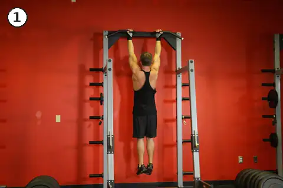

# Klimmzüge Untergriff

> Trifft zusätzlich den Bizeps.

- **Muskeln/Bereich:** Rücken, Bizeps
- **Equipment:** Klimmzugstange, Calisthenics
- **Kategorie:** Rücken
- **Erfassung:** Körpergewicht, Wiederholungen
- **Braucht die Klimmzugstange**

## Ausführung

- Untergriff schulterbreit.
- Schulterblätter zuerst nach unten ziehen.
- Brust zur Stange, Ellbogen eng am Körper.
- Kontrolliert ganz nach unten ablassen.

## Häufige Fehler

- Nur mit den Armen ziehen.
- Hohlkreuz und Schwung.

## Atmung

Ausatmen beim Hochziehen.

## Wo du es spürst

Rücken und Bizeps.

## Kommt vor in

- [Kraft C](../ablaeufe/kraft-c.md)
- [Skill Klimmzug, Stufe 4](../skills/klimmzug.md)
