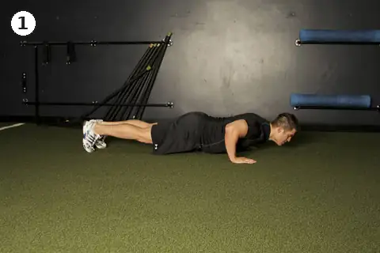

# Explosive Liegestütze

> Kräftig abdrücken, dass die Hände kurz abheben oder klatschen. Weich landen.

- **Muskeln/Bereich:** Brust, Schnellkraft
- **Equipment:** Körpergewicht, Calisthenics
- **Kategorie:** Brust
- **Erfassung:** Körpergewicht, Wiederholungen

## Kommt vor in

- [Skill Einarmiger Liegestütz, Stufe 5](../skills/einarmliege.md)
