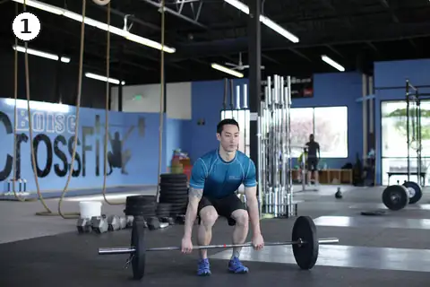

# Umsetzen und Drücken

> Stange explosiv vom Boden auf die Schultern umsetzen, dann über Kopf drücken. Jede Wiederholung kontrolliert absetzen.

- **Muskeln/Bereich:** Ganzkörper, Schultern
- **Equipment:** Langhantel
- **Kategorie:** Ganzkörper
- **Erfassung:** Gewicht und Wiederholungen, Steigerung 2.5 kg
- **Hantel:** Langhantel

## Kommt vor in

- [Vorlage Langhantel kompakt](../ablaeufe/vorlagen/x-lh.md)
- [Skill Überkopfdrücken, Stufe 3](../skills/ohp.md)
- [Skill Umsetzen (Power Clean), Stufe 4](../skills/umsetzen.md)
- [Skill Überkopf-Kniebeuge, Stufe 3](../skills/ohs.md)
