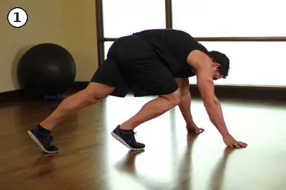

# Mountain Climber

> Hände unter den Schultern, Po nicht hoch, Knie zügig zur Brust.

- **Muskeln/Bereich:** Core, Kondition
- **Equipment:** Körpergewicht
- **Kategorie:** Kondition
- **Erfassung:** Sekunden (Halten)

## Ausführung

- Hände unter den Schultern.
- Po auf Schulterhöhe.
- Knie zügig zur Brust.

## Häufige Fehler

- Po hoch.

## Atmung

Rhythmisch atmen.

## Wo du es spürst

Bauch und Puls.

## Kommt vor in

- [Vorlage Tabata Ganzkörper](../ablaeufe/vorlagen/x-tabata.md)
- [Kondition + Core-Zirkel](../ablaeufe/gefuehrt/circuit.md)
