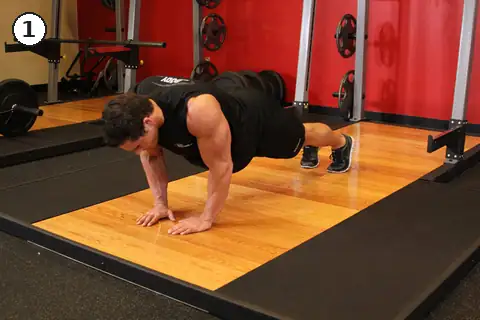

# Enge Liegestütze

> Hände eng unter der Brust, Ellbogen nah am Körper. Zu schwer: Hände auf die Bank.

- **Muskeln/Bereich:** Trizeps, Brust
- **Equipment:** Körpergewicht, Calisthenics
- **Kategorie:** Arme
- **Erfassung:** Körpergewicht, Wiederholungen

## Ausführung

- Hände unter der Brust, eng.
- Körper eine Linie, Po fest.
- Ellbogen streifen beim Absenken den Körper.

## Häufige Fehler

- Ellbogen nach außen.

## Atmung

Ausatmen beim Hochdrücken.

## Wo du es spürst

Trizeps.

## Kommt vor in

- [Kraft B · Beine](../ablaeufe/kraft-b.md)
- [Skill Einarmiger Liegestütz, Stufe 1](../skills/einarmliege.md)
