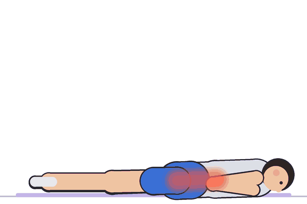

# Kobra

> Bauchlage, Hände unter den Schultern. Mit dem Einatmen Brust heben, Ellbogen bleiben nah am Körper und leicht gebeugt, Schambein bleibt am Boden.

- **Muskeln/Bereich:** Rücken, Bauch, Brust
- **Equipment:** Körpergewicht
- **Kategorie:** Mobility
- **Erfassung:** Sekunden (Halten)

## Ausführung

- Hände unter den Schultern, Finger weit, Ellbogen eng am Körper.
- Schambein und Fußrücken drücken leicht in den Boden.
- Mit dem Einatmen das Brustbein nach vorn oben schieben, nicht den Kopf in den Nacken werfen.
- Schultern weg von den Ohren, Schulterblätter sinken Richtung Gesäß.

## Häufige Fehler

- Arme ganz durchdrücken und ins Hohlkreuz hängen.
- Schultern hochziehen.

## Atmung

Einatmen beim Heben, ausatmen beim Ablegen.

## Wo du es spürst

Dehnung im Bauch und in der Brust, Arbeit im Rücken, kein Stechen im unteren Rücken.

## Kommt vor in

- [Mobility nach Gefühl: Oberer Rücken](../mobility/koerperbereiche.md)
- [Yoga nach Gefühl](../mobility/yoga-baukasten.md)
