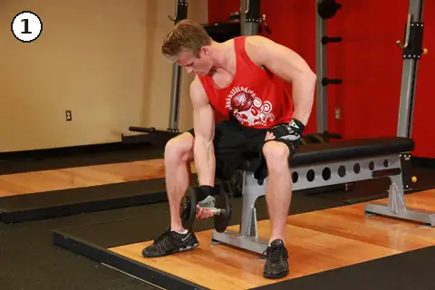

# Konzentrations-Curls

> Sitzend, Ellbogen an der Innenseite des Oberschenkels, oben fest anspannen.

- **Muskeln/Bereich:** Bizeps
- **Equipment:** Kurzhanteln, Bank
- **Kategorie:** Arme
- **Erfassung:** Gewicht und Wiederholungen, Steigerung 2 kg
- **Pro Seite** ausführen
