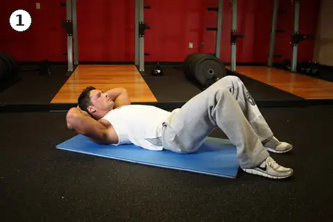

# Crunch diagonal

> Ellbogen diagonal zum gegenüberliegenden Knie, langsam abwechseln.

- **Muskeln/Bereich:** Bauch schräg
- **Equipment:** Körpergewicht
- **Kategorie:** Core
- **Erfassung:** Körpergewicht, Wiederholungen
