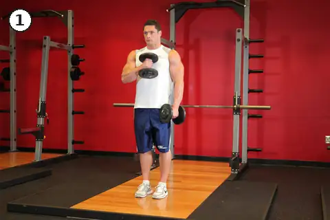

# Hammer Curls über den Körper

> Hantel im Hammergriff diagonal Richtung gegenüberliegende Schulter heben.

- **Muskeln/Bereich:** Oberarmmuskel, Unterarm
- **Equipment:** Kurzhanteln
- **Kategorie:** Arme
- **Erfassung:** Gewicht und Wiederholungen, Steigerung 1 kg
- **Hantel:** zwei Kurzhanteln
